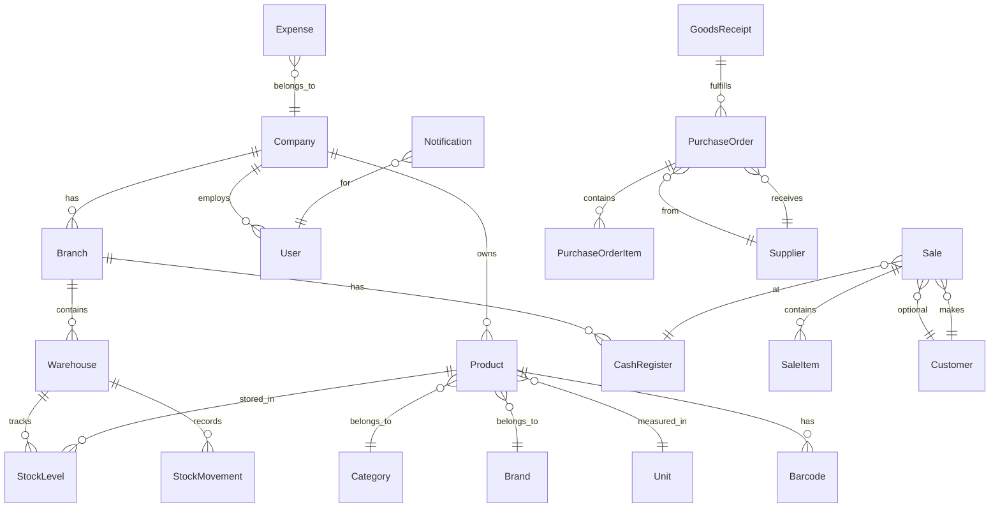

# Inventra — Schéma de Base de Données

## Diagramme relationnel (simplifié)



## Tables par module

### core (mixins partagés)
Pas de table — abstractions `TimeStampedModel`, `CompanyScopedModel`.

### companies
| Table | Champs clés |
|-------|------------|
| `subscription_plans` | name, price, max_users, max_branches, max_products, is_active |
| `companies` | name, slug, logo, email, phone, address, country, currency, tax_rate, is_active |
| `subscriptions` | company_id, plan_id, status, start_date, end_date |

### accounts
| Table | Champs clés |
|-------|------------|
| `users` | email, phone, password, first_name, last_name, company_id, is_active |
| `roles` | name, code, company_id (null = système) |
| `permissions` | codename, name, module |
| `role_permissions` | role_id, permission_id |
| `user_roles` | user_id, role_id, branch_id (scope optionnel) |

### branches
| Table | Champs clés |
|-------|------------|
| `branches` | company_id, name, address, phone, is_active |
| `cash_registers` | branch_id, name, is_open, opened_by, opened_at |

### warehouses
| Table | Champs clés |
|-------|------------|
| `warehouses` | branch_id, name, is_default |

### units / categories / brands
| Table | Champs clés |
|-------|------------|
| `units` | company_id, name, abbreviation |
| `categories` | company_id, name, parent_id (hiérarchie) |
| `brands` | company_id, name |

### products
| Table | Champs clés |
|-------|------------|
| `products` | company_id, name, sku, category_id, brand_id, unit_id, purchase_price, sale_price, tax_rate, min_stock, max_stock, image, is_active |
| `barcodes` | product_id, code, is_primary |
| `product_batches` | product_id, batch_number, expiry_date, quantity |

### inventory
| Table | Champs clés |
|-------|------------|
| `stock_levels` | product_id, warehouse_id, quantity (unique together) |
| `stock_movements` | product_id, warehouse_id, type, quantity, reference, user_id, notes |
| `stock_transfers` | from_warehouse_id, to_warehouse_id, status, created_by |
| `stock_transfer_items` | transfer_id, product_id, quantity |
| `stock_adjustments` | warehouse_id, reason, created_by |
| `stock_adjustment_items` | adjustment_id, product_id, expected_qty, actual_qty |

### sales
| Table | Champs clés |
|-------|------------|
| `sales` | company_id, branch_id, cash_register_id, customer_id, seller_id, reference, status, subtotal, tax_amount, discount_amount, total, payment_status |
| `sale_items` | sale_id, product_id, quantity, unit_price, tax_rate, discount, total |
| `payments` | sale_id, method, amount, reference, status |
| `sale_returns` | sale_id, reason, status, refund_amount |
| `sale_return_items` | return_id, sale_item_id, quantity |

### purchases
| Table | Champs clés |
|-------|------------|
| `purchase_orders` | company_id, supplier_id, reference, status, total, expected_date |
| `purchase_order_items` | order_id, product_id, quantity, unit_price, total |
| `goods_receipts` | order_id, warehouse_id, received_by, received_at |
| `goods_receipt_items` | receipt_id, product_id, quantity_received |

### customers / suppliers
| Table | Champs clés |
|-------|------------|
| `customers` | company_id, name, phone, email, address, credit_limit, balance |
| `suppliers` | company_id, name, phone, email, address, balance |

### expenses
| Table | Champs clés |
|-------|------------|
| `expense_categories` | company_id, name |
| `expenses` | company_id, category_id, branch_id, amount, description, date, created_by |

### notifications
| Table | Champs clés |
|-------|------------|
| `notifications` | user_id, type, title, message, is_read, data (JSON) |
| `notification_rules` | company_id, event_type, threshold, is_active |

### settings_app
| Table | Champs clés |
|-------|------------|
| `company_settings` | company_id, key, value (JSON) |

### authentication (pas de table)
Gère les vues JWT — utilise `accounts.User`.

## Index recommandés

```sql
-- Performance critiques
CREATE INDEX idx_products_company_sku ON products(company_id, sku);
CREATE INDEX idx_barcodes_code ON barcodes(code);
CREATE INDEX idx_stock_levels_product_warehouse ON stock_levels(product_id, warehouse_id);
CREATE INDEX idx_sales_company_date ON sales(company_id, created_at);
CREATE INDEX idx_stock_movements_warehouse_date ON stock_movements(warehouse_id, created_at);
CREATE INDEX idx_users_company_email ON users(company_id, email);
```

## Conventions

- Toutes les tables métier ont `created_at`, `updated_at`
- Soft delete via `is_active` (pas de suppression physique)
- `company_id` sur toutes les entités métier (multi-tenant)
- Références uniques par entreprise : `reference` préfixé (ex: `VTE-2026-0001`)
- Montants en `Decimal(12, 2)`, quantités en `Decimal(10, 3)`
- Statuts en `CharField` avec choices explicites

## Mapping Django Apps

| App Django | Tables |
|-----------|--------|
| `core` | Mixins uniquement |
| `companies` | subscription_plans, companies, subscriptions |
| `accounts` | users, roles, permissions, role_permissions, user_roles |
| `branches` | branches, cash_registers |
| `warehouses` | warehouses |
| `units` | units |
| `categories` | categories |
| `brands` | brands |
| `products` | products, barcodes, product_batches |
| `inventory` | stock_levels, stock_movements, stock_transfers, stock_adjustments |
| `sales` | sales, sale_items, payments, sale_returns |
| `purchases` | purchase_orders, goods_receipts |
| `customers` | customers |
| `suppliers` | suppliers |
| `expenses` | expense_categories, expenses |
| `notifications` | notifications, notification_rules |
| `settings_app` | company_settings |
